<div align="center">


<a href="https://www.linkedin.com/in/tanush-bharadwaj-b08092324/"></a>
<a href="https://www.youtube.com/@GenzisOfficial"></a>
<a href="https://x.com/Genzis_Official"></a>
<a href="https://discord.com/channels/1506271880758296726"></a>
<a href="mailto:tanushbharadwaj2514@gmail.com"></a>
<a href="https://github.com/Genzis-Generations-Ahead"></a>

<br/><br/>


</div>



<details>
<summary><b>🔒 &nbsp;CLASSIFIED FILE &nbsp;—&nbsp; <code>tanush.config.ts</code> &nbsp;(click to decrypt)</b></summary>
<br/>

```ts
// clearance: LEVEL 5  ·  do not leak to recruiters (ok fine, leak it)
export const tanush = {
  role:     ["Founder & CEO @ Genzis", "Application Developer @ MDX23 LLC"],
  builds:   "machines that sense the human body",
  stack:    {
    hw: ["ESP32-S3", "Raspberry Pi", "BioAmp EXG", "Arduino"],
    sw: ["Python", "React", "Node", "FastAPI", "Java"],
  },
  sidekick: "Zix",
  rule:     "if it doesn't ship, it doesn't exist",
  sleep:    undefined, // TODO
} as const;
```

```console
$ zix --help
  zix ship        pushes to main with confidence it hasn't earned
  zix hydrate     reminds tanush that water exists
  zix explain     explains the commit message nobody understood
  zix party       confetti. that's it. that's the command.
```

</details>

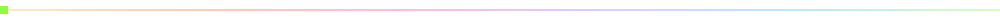


<table>
<tr>
<td width="50%"><a href="https://github.com/Genzis-Generations-Ahead/Saavi"></a></td>
<td width="50%"><a href="https://github.com/Genzis-Generations-Ahead/gloog"></a></td>
</tr>
<tr>
<td width="50%"><a href="https://github.com/Genzis-Generations-Ahead/guardian-relay"></a></td>
<td width="50%"><a href="https://github.com/tanush69lucifer/codethon-portal"></a></td>
</tr>
<tr>
<td width="50%"></td>
<td width="50%"></td>
</tr>
</table>


| | Quest | What it does | Stack |
|:-:|:--|:--|:--|
| 🩺 | **Mediosis** | Reads medical report scans, returns structured JSON health summaries | `Python` `Tesseract` `Flask` |
| 🔒 | **Aether Grid** | Minimises your screen the moment someone walks up behind you | `Arduino` `PIR` `Python` `JS` |
| 👁️ | **Camera Motion Locker** | Locks the device when an unknown face shows up | `OpenCV` `Face recognition` |
| 🖼️ | **Image Processing Server** | REST API for real-time filtering and object detection | `Flask` `OpenCV` |
| 📈 | **GLOOM** | Portable portfolio risk analytics engine | `Python` |
| 🌌 | **CREO** | Sandbox particle-physics simulator with live collisions | `JS` `Canvas` |
| ✅ | **StudyFlow** | Full-stack task manager | `React` `Node` `MongoDB` |






<table>
<tr>
<td width="50%" align="center">
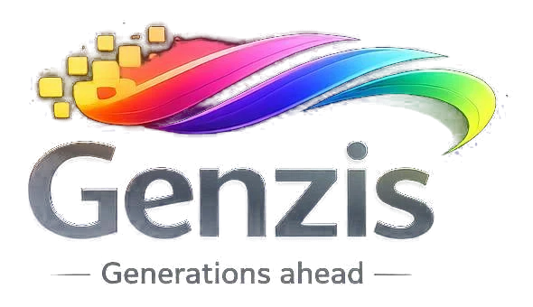
<br/><br/>
<b>Generations Ahead.</b><br/>
<sub>Health-tech hardware, AI and software, built by a crew that ships first and sleeps later.</sub>
<br/><br/>
<a href="https://github.com/Genzis-Generations-Ahead"><code>github</code></a> ·
<a href="https://www.youtube.com/@GenzisOfficial"><code>youtube</code></a> ·
<a href="https://x.com/Genzis_Official"><code>x</code></a> ·
<a href="mailto:genzis.hq@gmail.com"><code>genzis.hq@gmail.com</code></a>
</td>
<td width="50%" align="center"></td>
</tr>
</table>


<div align="center">


</div>


<div align="center">

</div>
